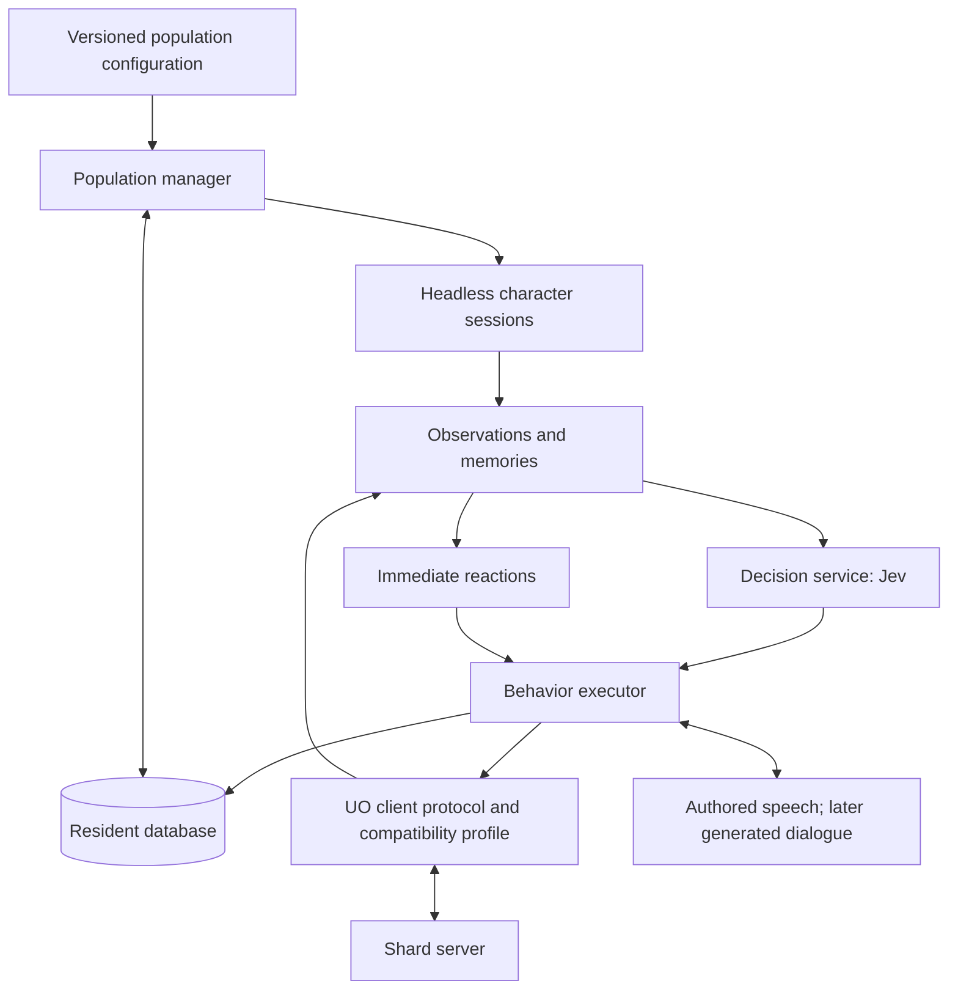

# Design

[Documentation index](README.md)

## Goal

Populate a shard with persistent characters controlled by a separate process. They should behave like players: move through the world, talk, interact, gather resources, train skills, craft, trade, fight, die, find resurrection, recover belongings, and continue their lives.

A decision model such as TypeSafe's Jev selects among meaningful choices. The runtime maintains each character's observations, memory, personality, goals, and ongoing behavior. The shard remains authoritative over everything that happens in the game.

Population creation is deliberate. Operators define templates for particular kinds of characters, starting cities, skills, and preferences. Residents persist instead of being rerolled on every launch. Eventually, an operator supplies a number indicating the desired concurrent population.

## Agreed decisions

| Concern | Decision |
| --- | --- |
| Process boundary | AI runs externally in a separate process. |
| Implementation location | Implementation, tests, configuration, and local state belong under top-level `ai/`. Documentation belongs under `ai/docs/`, with a small index and focused topic files. |
| Emulator support | ServUO only, read from the shard's `gemwright.json` ([sessions](sessions.md)). Decision and behavior layers stay independent of emulator internals. |
| Game rules | Full parity with ordinary players. No privileged actions, free resurrection, resource injection, or hidden-world inspection during play. |
| Character creation | Explicit, versioned templates define starting conditions and behavioral preferences. Actual starting builds must comply with supported shard creation rules. |
| Identity | Stable residents retain history across restarts, crashes, template changes, and population reductions. |
| Occupations | Templates influence preferences; they do not lock characters into classes or prohibit other skills. |
| Population | A desired concurrent count, allocated across templates by weights or explicit counts. |
| Decisions | Jev is the initial intended decision provider. Decision execution remains controlled by code. |
| Speech | Authored responses tied to actual state; Jev reads intent and picks replies. Generated phrasing comes later behind the same boundary. |

Credentials are never printed, committed, or placed in templates, checkpoints, or model state. The TypeSafe key comes from `TYPESAFE_API_KEY` in the environment (Bun loads the repository root's `.env` when commands run from there); game-account credentials live only in the resident database.

## Reference projects and evidence

[UO Offline](https://github.com/Klein187/uo-offline) demonstrates a population with travel, shopping, combat, parties, resurrection, and corpse recovery on ModernUO. Its [PlayerBot implementation](https://github.com/Klein187/uo-offline/blob/main/playerbots/source/CustomBots/PlayerBot.cs) subclasses `PlayerMobile` and attaches interchangeable behaviors. It is useful behavioral research; it is not the proposed external integration boundary, and this implementation does not copy its code.

Existing NPC frameworks, including [ServUO BaseAI](https://github.com/ServUO/ServUO/blob/pub57/Scripts/Mobiles/AI/BaseAI.cs) and [Sphere-X NPC actions](https://github.com/Sphereserver/Source-X/blob/master/src/game/chars/CCharNPCAct.cpp), are useful for understanding mechanics and existing approaches. The external runtime must not depend on their internal AI classes.

TypeSafe describes Jev as a System One decision model: application state and typed questions produce structured decisions and probabilities. It does not generate conversation or explanations. [System One](https://docs.typesafe.ai/concepts/system-one), [workflow guidance](https://docs.typesafe.ai/concepts/how-to-build-with-system-one.md), and [Choice](https://docs.typesafe.ai/primitives/choice.md) inform the decision boundary below. A model's confidence is not proof that a proposed action is legal or wise.

## Architecture

### External runtime and headless clients

The implemented connection mechanism is the ordinary UO client protocol. Each active resident has a normal character session. A headless client performs the networking and client-side state handling without rendering a game window.

An external process alone does not guarantee emulator independence. A custom bridge for each emulator would still require adapters and could accidentally bypass player rules. Ordinary client sessions provide the strongest default boundary: the server validates actions through its existing player paths.

The implementation uses a small TypeScript TCP client rather than embedding a rendering client or binding to C# emulator internals. It reuses Gemwright’s BSD-2-Clause Huffman decoder in `client/huffman.ts`. Protocol framing and packet layouts were checked against ServUO pub57 revision `d76bf4443cf76d081ddaf8f57c87ff33749256af`. The available compatibility profile is deliberately limited to an unencrypted classic client identifying as `7.0.45.1`; other emulator/version/encryption combinations are rejected rather than advertised as supported.

The shard profile (`shard-profile.ts`) adds the expansion and account settings from the shard's `gemwright.json`; era rules such as Stealth requirements follow the expansion. Custom shard scripts and UI are out of scope: the runtime plays base ServUO.

### Population manager

The manager maintains a stable roster and a desired active subset. It is responsible for allocation, session lifecycle, reconnect scheduling, and eventually orderly logout. It does not choose combat targets or edit game state.

The roster persists `desiredActive`; a reconciliation's active count means **desired active residents**, not characters actually online. The `session` command runs one resident, and `population` runs all of them in one process ([population](population.md)).

Current wire-session phases are `offline`, `login`, `relay`, `characters`, `entering`, `ready`, and `failed`. A resident with no binding is unprovisioned. Reconnection creates a new session and rebuilds observations; the resident identity, credentials, and bound character serial are preserved.

A SQLite lease excludes a second runtime using the same shard database. It expires after 30 seconds, renews every 10 seconds, and checks its token on renewal/release. Outgoing actions check local lease validity, and lease loss closes the session. Expired owners cannot renew or release a replacement owner’s lease. This is local database ownership, not a distributed deployment coordinator or protection across independently copied databases.

### Perception and world knowledge

A resident may use information available to a player: received entities, visible or otherwise legitimately exposed properties, inventory, journal messages, public map data, remembered locations, and communication. It cannot query unseen monsters, hidden players, private inventories, or unexplored dynamic conditions through privileged server access.

Public static map knowledge can support pathfinding in the same way that a player can use map assets. Dynamic knowledge must come from observations or remembered reports. Reports may be stale or wrong; memory must preserve provenance and time rather than silently turn hearsay into live truth.

Persist useful knowledge, not an unbounded copy of every packet. Define bounded retention, expiration, and consolidation before accumulating long-lived population histories.

### Decision service

Jev receives a bounded description of the resident and relevant situation, plus a constrained set of candidates. Typical questions include:

- Which activity should this character pursue next?
- Is this hunting situation worth the risk given supplies and recent deaths?
- Should the character accept an invitation, decline it, or ask for clarification?
- After resurrection, should it attempt recovery, seek help, or replace equipment?

Code constructs candidate options with stable identifiers and known parameters. The model does not invent entity serials, executable code, credentials, or unrestricted commands. Validate the selected option and recheck its preconditions before execution.

Use meaningful decisions rather than a model call per movement step. Immediate reactions must work while a request is pending or unavailable. Tag requests with the resident's observation/decision revision and discard responses whose context has become invalid. Death, disconnection, a changed target, and an interrupted action can all invalidate an answer.

Probability and confidence can inform fallback selection after evaluation, but initial thresholds require measured game outcomes. Do not interpret output probabilities as a requirement to sample actions randomly. If controlled variety is later useful, make its policy explicit and reproducible.

Keep model selection configurable and record the model identifier and decision configuration used during evaluation. Establish timeout, concurrency, retry, and spending limits before increasing population. A model outage must not disable basic defense or cause unbounded retries.

### Behavior executor and immediate reactions

The executor turns intentions into interruptible sequences of ordinary player actions. It tracks a behavior's phase, pending interaction, expected feedback, deadline, and outcome.

For example, mining requires more than selecting a skill: obtain a tool, reach suitable terrain, initiate tool use, answer targeting, interpret server feedback, handle resource depletion, respect weight limits, and bank or sell the result. A server accepting a packet does not necessarily mean the intended action succeeded.

Primitive actions include moving, speaking, using an item, equipping, requesting a skill, targeting, casting, interacting with a menu, lifting/dropping items, and responding to trade or party interfaces. Full behaviors compose these primitives.

Every behavior needs explicit success, failure, timeout, interruption, and cancellation paths. There must be at most one owner for mutually exclusive interactions such as a target cursor or drag operation. Handle movement acknowledgement and correction before issuing dependent movement.

Immediate reactions cover damage, emergency healing, retreat, death, disconnection, and movement failure. These are local rules with configurable priorities. They interrupt or suspend slower activity decisions. The server still enforces legality and timing.

### Conversation

Speech goes through the same interface a player has, and replies come from real state ([conversation](conversation.md)). A spoken agreement must become a supported intention: accepting an invitation starts the cooperation it promised, and a character never claims an action that did not succeed. Player speech is game input; it grants no access to credentials, administration or privileged actions.

Related: [Roadmap and acceptance criteria](roadmap.md) · [Headless player sessions](sessions.md).
